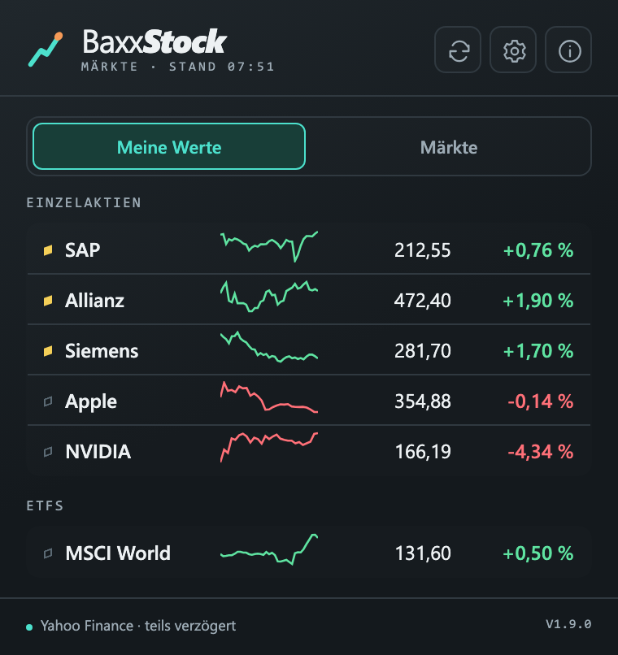
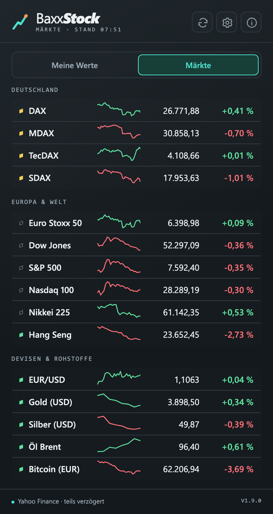

<div align="center">


# BaxxStock

**Börsenkurse im Chrome-Popup – ein Klick, alles Wichtige auf einen Blick.**


<br>


&nbsp;&nbsp;


<sub>Beispielansicht mit Kursen vom Morgen des 13.11.2026</sub>

</div>

## Was ist BaxxStock?

BaxxStock ist eine schlanke Chrome-Erweiterung. Ein Klick auf das Icon zeigt Indizes, Devisen, Rohstoffe und deine eigenen Aktien und ETFs – mit Kurs, Tagesveränderung und Mini-Kurve. Ohne Konto, ohne API-Key, ohne Tracking.

## Funktionen

**Märkte**
- Indizes: DAX, MDAX, TecDAX, SDAX, Euro Stoxx 50, Dow Jones, S&P 500, Nasdaq 100, Nikkei 225, Hang Seng
- Devisen & Rohstoffe: EUR/USD, Gold, Silber, Brent, Bitcoin
- Jeden Standard-Wert einzeln ein- und ausblendbar

**Meine Werte**
- Eigene Watchlist mit beliebigen Yahoo-Symbolen (`SAP.DE`, `AAPL`, `IWDA.AS` …)
- Automatisch gruppiert nach Einzelaktien, ETFs und Sonstige
- Depot-Import: Ansicht der Bank in die Textarea einfügen – Symbole werden über die ISIN gefunden

**Anzeige**
- Kurs, Veränderung zum Vortag in % und Mini-Kursverlauf des Handelstages
- Statuspunkt pro Wert: handelt, vor-/nachbörslich oder geschlossen (Hover zeigt Datum und Uhrzeit des Kurses)
- Dark Mode, Info-Bereich mit Erklärungen, Einstellungen über Chrome Sync

## Installation

Die Erweiterung ist (noch) nicht im Chrome Web Store und wird als entpackte Erweiterung geladen:

1. Repository klonen oder als ZIP herunterladen und entpacken
   ```bash
   git clone https://github.com/baxxus/BaxxStock.git
   ```
2. In Chrome `chrome://extensions` öffnen und oben rechts den **Entwicklermodus** aktivieren
3. **Entpackte Erweiterung laden** wählen und den Projektordner auswählen
4. Das Icon über das Puzzle-Symbol in der Toolbar anheften

## Bedienung

| Aktion | So geht's |
|---|---|
| Kurse neu laden | Pfeil-Symbol oben rechts (sonst 1 Minute Zwischenspeicher) |
| Wert hinzufügen | Zahnrad → Symbol eingeben, optional mit Namen: `ALV.DE Allianz` |
| Depot importieren | Zahnrad → „Liste importieren“ → Text einfügen → Importieren |
| Standard-Werte ausblenden | Zahnrad → „Standard-Werte“ → Haken entfernen |
| Erklärungen lesen | Info-Symbol oben rechts |

**Symbol-Schreibweise bei Yahoo:** Xetra `.DE` (`SAP.DE`), US-Aktien ohne Endung (`AAPL`), Amsterdam `.AS`, Futures `=F`, Devisen `=X`. Symbole findest du auf [finance.yahoo.com](https://finance.yahoo.com).

### Depot-Import

Unterstützt werden zwei Formate:

- **Freitext** aus der Depotansicht der Bank: je Position die Reihenfolge Name, ISIN, Stück, Wert
- **Tabelle** mit den Spalten `Name`, `ISIN`, `Stück/Nominal`, `Wert`, getrennt durch Tab oder Semikolon, z. B.
  ```
  SAP SE;DE0007164600;10;1.234,56
  ```

## Datenschutz

- Es gibt keinen eigenen Server – das Popup spricht direkt mit Yahoo Finance
- Beim Import werden **nur die ISINs** an Yahoo gesendet (Symbolsuche)
- Stück und Wert deiner Positionen bleiben **lokal im Browser** und werden nicht über Chrome Sync geteilt
- Berechtigungen: nur `storage` sowie Zugriff auf `query1`/`query2.finance.yahoo.com`

## Datenquelle & Hinweis

Kurse stammen von Yahoo Finance (inoffizielle Schnittstelle, kein API-Key nötig) und können je nach Börse rund 15 Minuten verzögert sein. Da die Schnittstelle nicht offiziell ist, kann sie sich jederzeit ändern. **Keine Anlageberatung.**

## Projektaufbau

| Datei | Aufgabe |
|---|---|
| `manifest.json` | Chrome-Manifest (V3) |
| `popup.html` / `popup.css` | Oberfläche des Popups |
| `popup.js` | Kursabruf, Darstellung, Einstellungen |
| `import.js` | Parser für den Listen-Import |

Es gibt keinen Build-Schritt und keine Abhängigkeiten – Dateien ändern, in `chrome://extensions` neu laden, fertig.

## Lizenz

Apache License 2.0, siehe [LICENSE](LICENSE).
